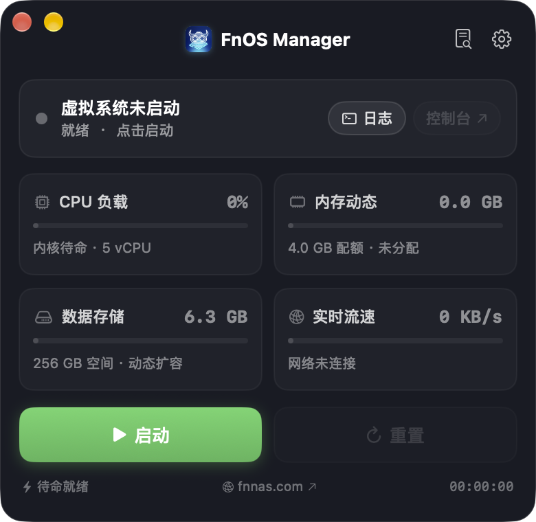
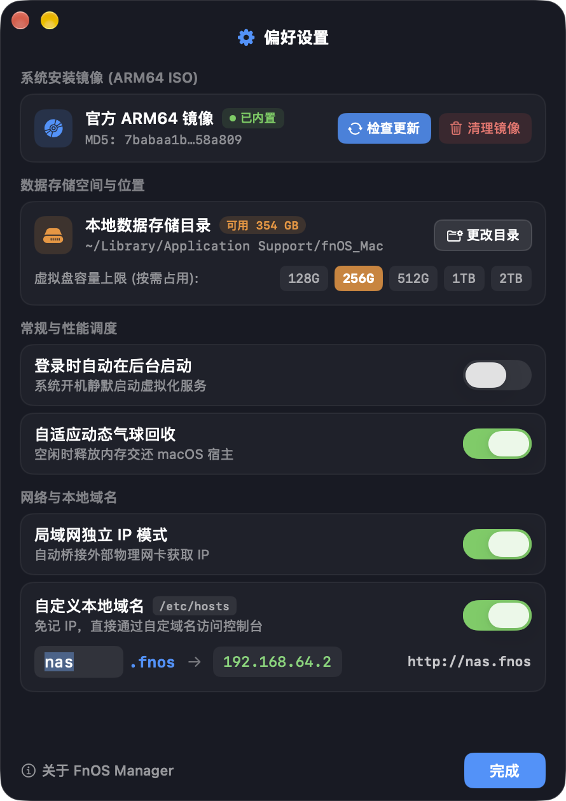
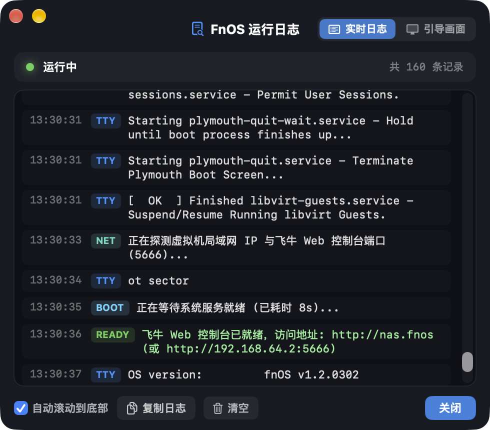
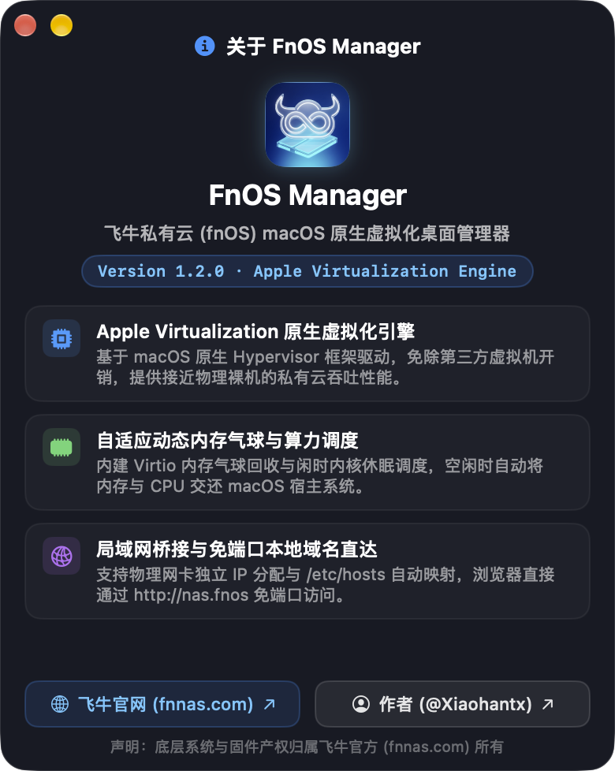

<div align="center">
  
  <h1>FnOS Manager</h1>
  <p><strong>飞牛私有云 (fnOS) 全平台原生虚拟化桌面管理器 (macOS &amp; Windows)</strong></p>
  <p>
    
    
    
    
  </p>
</div>

---

## 📖 项目简介

**FnOS Manager** 是一款专为 **Apple Silicon (`M1` / `M2` / `M3` / `M4`) Mac** 与 **Windows 10/11 (`x86_64` / `ARM64`) 电脑** 打造的轻量级原生 **飞牛私有云 (fnOS)** 桌面虚拟化管理器。

无需繁琐配置第三方虚拟机或手动引导向导 —— **FnOS Manager** 在 macOS 上基于苹果官方 `Virtualization.framework` 原生 Hypervisor，在 Windows 上基于微软原生 `Hyper-V / WHPX` 内核，提供**官方镜像一键获取、全自动无人值守安装、外置硬盘存储目录动态扩容、自适应内存调度与回垦、以及 `http://nas.fnos` 本地域名直达**的高度统一体验。

---

## ✨ 界面预览

| 主控卡片界面 | 偏好设置与外置存储管理 |
| :---: | :---: |
|  |  |

| 实时运行日志与引导画面 | 关于 FnOS Manager |
| :---: | :---: |
|  |  |

---

## 🚀 核心特性

- **⚡ Apple Virtualization 原生虚拟化引擎**
  - 直接调用 macOS 底层 `Virtualization.framework`，零第三方虚拟化层损耗，接近物理裸机 I/O 与网络吞吐性能。
- **💿 官方 ARM64 镜像内置签名下载 & 全自动无人值守安装**
  - 内置对接飞牛官方签名接口，一键在线获取最新 ARM64 ISO 镜像并自动校验 MD5。
  - **全自动无人值守安装引擎**：首次启动自动完成 GPT 分区、格式化、系统归档解压、UEFI 引导配置并自动重启进入正式系统，全程无需手动点击安装界面。
- **💽 支持外置硬盘存储目录 & 稀疏动态扩容 & 自动数据迁移**
  - 支持将飞牛「存储空间」数据盘（`/dev/vdb`）与 `Shared` 共享目录直接挂载在**外置移动硬盘/雷电硬盘盒的任意文件夹**中。
  - 支持 `128GB` / `256GB` / `512GB` / `1TB` / `2TB` 动态稀疏文件（Sparse File），按实际存入文件占用磁盘空间，不预先占用宿主硬盘。
  - 更换存储目录时，利用 `SEEK_DATA` / `SEEK_HOLE` 极速迁移有效数据块至新位置，并自动清理旧目录文件。
- **🎈 VirtIO 动态内存气球回收 (Ballooning)**
  - 内置 `VMPerformanceEngine`，根据虚拟系统负载与 macOS 宿主内存压力动态伸缩内存，闲时自动将物理内存交还 macOS。
- **🌐 本地域名直达 (`http://nas.fnos`) & 代理免疫**
  - 自动配置 `/etc/hosts` 映射与 DHCP 固定租约匹配，并自动将 `*.fnos` 写入 macOS 系统代理忽略列表（免受 Clash / Surge / TUN 代理干扰），浏览器直接输入 `http://nas.fnos` 即可访问飞牛 Web 控制台。
- **📟 实时双模日志查看器**
  - 内置独立日志窗口，支持「实时日志流」与「UEFI / Linux 引导终端画面」一键切换。

---

## 🛠️ 快速开始

### 1. 环境要求
- **硬件**：搭载 Apple Silicon (`M1` / `M2` / `M3` / `M4`) 芯片的 Mac
- **系统**：macOS 14.0 (Sonoma) 及以上版本
- **编译环境**：Xcode Command Line Tools (`xcode-select --install`)

### 2. 直接下载安装包（推荐）

前往 [GitHub Releases](https://github.com/Xiaohantx/FnOS-Manager/releases) 下载最新版本的安装包：

| 平台 / 架构 | 下载文件 | 推荐设备 |
| :--- | :--- | :--- |
| 🍏 **macOS (ARM64)** | [**FnOS-Manager-1.0.3-arm64.dmg**](https://github.com/Xiaohantx/FnOS-Manager/releases/latest) | Apple Silicon (M1/M2/M3/M4) Mac |
| 🪟 **Windows (x64)** | [**FnOS-Manager-1.0.3-windows-x64.zip**](https://github.com/Xiaohantx/FnOS-Manager/releases/latest) | Intel / AMD 64位 Windows 10/11 电脑 |
| 🪟 **Windows (ARM64)** | [**FnOS-Manager-1.0.3-windows-arm64.zip**](https://github.com/Xiaohantx/FnOS-Manager/releases/latest) | 骁龙 X Elite / Surface Pro / ARM 电脑 |

> **macOS 提示**：由于开源版本使用本地 Ad-hoc 签名以启用 Apple `com.apple.security.virtualization` 虚拟化权限，若首次打开提示「无法验证开发者」，可在终端执行一次 `sudo xattr -rd com.apple.quarantine "/Applications/FnOS Manager.app"`，或在「系统设置 → 隐私与安全性」中点击「仍要打开」。

### 3. 从源码克隆与一键编译打包

**macOS 平台**：
```bash
git clone https://github.com/Xiaohantx/FnOS-Manager.git
cd FnOS-Manager

# 一键编译、打包并自动签名生成 build/FnOS Manager.app
./scripts/build_app.sh

# 或者直接一键打包生成 DMG 安装镜像 (build/FnOS-Manager-1.0.3-arm64.dmg)
./scripts/build_dmg.sh 1.0.3

# 启动 FnOS Manager
./scripts/run.sh
```

**Windows 平台**：
```powershell
git clone https://github.com/Xiaohantx/FnOS-Manager.git
cd FnOS-Manager/windows

# 使用 .NET 8 编译独立可执行文件
./scripts/run.ps1 -Build -Arch x64     # 编译 x64
# ./scripts/run.ps1 -Build -Arch arm64 # 编译 ARM64
```

---

## 🧭 使用指南

1. **获取官方系统镜像**：
   - 首次打开 **FnOS Manager**，点击右上角齿轮图标进入 **「偏好设置」**，在「系统安装镜像 (ARM64 ISO)」卡片中点击 **「获取镜像」**，等待内置下载与校验完成。
2. **配置数据存储位置（可选外置硬盘）**：
   - 在 **「偏好设置 → 数据存储空间与位置」** 中点击 **「更改目录」**，可选择外置硬盘下的任意文件夹作为飞牛的数据存储目录，并按需选择虚拟盘容量上限（`128G` ~ `2TB`）。
3. **一键启动与全自动安装**：
   - 点击主界面 **「启动系统」**，首次启动会自动进入全自动无人值守安装（约需 40~60 秒），可点击 **「日志」** 实时查看安装进度。
   - 安装完成后会自动重启进入正式系统，状态指示灯变为绿色 **「虚拟系统运行中」**。
4. **访问飞牛 Web 控制台**：
   - 点击主界面右侧 **「控制台 ↗」** 按钮（或浏览器访问 `http://nas.fnos`），即可进入飞牛私有云初始化向导并创建管理员账号。

---

## 📂 项目目录结构

```text
FnOS-Manager/
├── Package.swift                        # Swift Package 配置
├── entitlements.plist                   # Apple Virtualization & 网络虚拟化权限声明
├── Resources/
│   ├── AppIcon.icns                     # macOS 应用圆角图标集
│   ├── AppLogo.png                      # 应用内高清矢量/光效徽章
│   ├── Info.plist                       # App Bundle 元信息配置
│   └── screenshots/                     # README 界面实机截图
├── Sources/
│   └── fnOSApp/
│       ├── App.swift                    # SwiftUI 应用主入口与多窗口注册
│       ├── Models/                      # 核心数据模型 (VMSettings, VMState, SharedFolder)
│       ├── Services/                    # 虚拟化与底层服务
│       │   ├── VMManager.swift          # Virtualization 生命周期与串口日志引擎
│       │   ├── StorageService.swift     # 稀疏磁盘、无人值守安装注入与跨盘数据迁移
│       │   ├── ISOFetcherService.swift  # 飞牛官方镜像签名获取与内置下载校验
│       │   ├── NetworkMonitor.swift     # DHCP 嗅探与 bridge100 端口探测/转发
│       │   ├── HostsManager.swift       # /etc/hosts 映射与系统代理自动绕过
│       │   └── VMPerformanceEngine.swift# VirtIO 内存气球动态回垦引擎
│       └── Views/                       # 原生毛玻璃 UI 组件 (MiniCardView, MiniSettingsSheetView...)
└── scripts/
    ├── build_app.sh                     # 一键编译、资源组装与 Entitlements 签名脚本
    ├── run.sh                           # 快速启动脚本
    └── generate_icon.swift              # 图标裁切与 .icns 生成脚本
```

---

## ⚠️ 免责声明

- **FnOS Manager** 为第三方开源的 macOS 虚拟化辅助管理工具，旨在方便 Mac 用户在 Apple Silicon 设备上体验与使用飞牛私有云。
- 飞牛私有云系统（fnOS）及其固件镜像的相关商标与知识产权归属 **飞牛官方 ([fnnas.com](https://fnnas.com/))** 所有。

---

## 📄 开源协议

本项目基于 [MIT License](LICENSE) 协议开源。欢迎提交 Issue 与 Pull Request！
